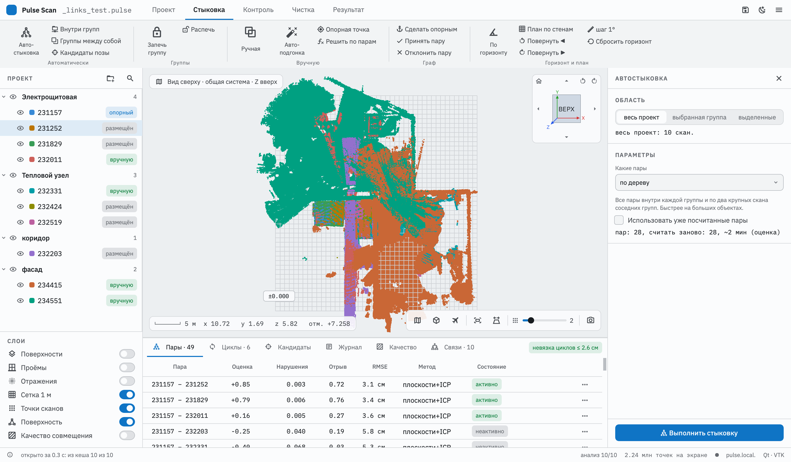
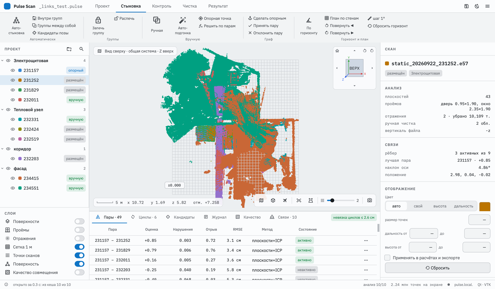
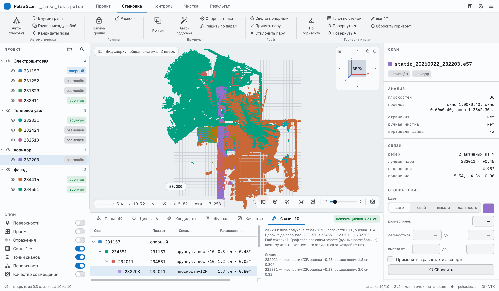
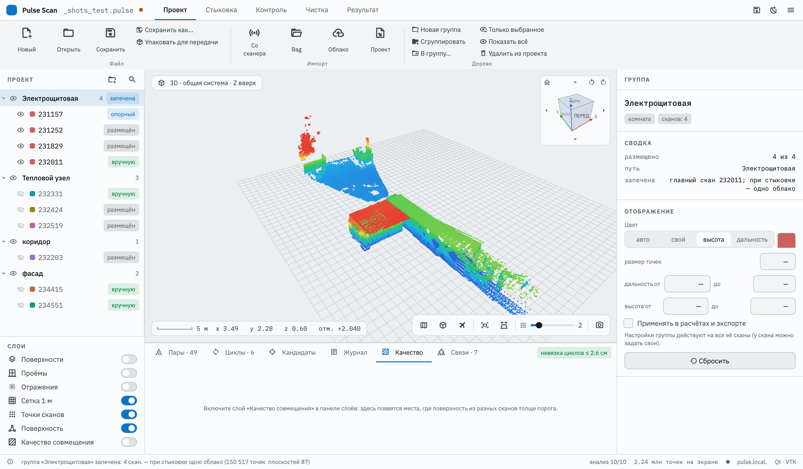

# Pulse Scan — что нового в 0.9.0-rc5

Версия программы: **0.9.0-rc5** (релиз-кандидат) · октябрь 2026

Выдержка из руководства пользователя: только то, что появилось или изменилось по сравнению с версией 0.9.0-rc4. Номера разделов — как в полном руководстве (F1 в программе, `Руководство/PulseScan-manual.pdf` в пакете).

Главное:

1. **панели инструментов** — у каждого инструмента с параметрами своя панель справа с кнопкой «Выполнить»;
2. **запекание групп** — состыкованная группа стыкуется с остальными как одно облако;
3. **настройки отображения** скана и группы — цвет, размер точек, обрезка по дальности и высоте;
4. **импорт проекта в проект**;
5. **стыковка**: автостыковка выделенных сканов, далёкие сканы (улица, парковка), «Принять позу» больше не сдвигает скан;
6. **вкладка «Связи»** — почему скан стоит именно так; **подсказки** к таблице пар;
7. **«Открыть недавние»**.

---

## Содержание

1. [Окно: панели инструментов](#окно-панели-инструментов)
2. [Проект и импорт](#проект-и-импорт)
3. [Отображение облака](#отображение-облака)
4. [Стыковка](#стыковка)
5. [Другие изменения](#другие-изменения)

---

## Окно: панели инструментов

Вкладка ленты теперь показывает только команды своего этапа и правую панель не переключает. Правая панель без открытого инструмента — сведения и настройки отображения выбранного скана или группы.

### Как работают инструменты

| Вид инструмента | Что происходит по нажатию | Примеры |
|---|---|---|
| **Без параметров** | срабатывает сразу | Сохранить, По горизонту, Принять пару, Запечь группу, Удалить |
| **С параметрами** | справа открывается **панель инструмента**: область (выбранный скан, группа, весь проект), параметры, оценка (сколько пар, сколько времени), кнопка **«Выполнить»**, внизу — прогресс и **«Остановить»**, ниже — результат | Автостыковка, Кандидаты позы, Качество, Движущиеся объекты, Поверхность, Экспорт, Упаковка |
| **Режим** | панель + действия мышью в 3D-виде; внизу **«Готово»** | Ручная стыковка, Сечение, Нулевой уровень, Замеры, Рамка |

**Shift + щелчок** по кнопке инструмента — выполнить сразу с прошлыми настройками, без панели. Настройки запоминаются между запусками.

Панель остаётся открытой после запуска (можно поменять параметры и запустить ещё раз) и при переходе на другую вкладку ленты. Закрыть — крестик в заголовке или **Esc**; тогда справа снова сведения о выбранном объекте.

## Проект и импорт

**Открыть недавний проект.**

| Действие | Как |
|---|---|
| Открыть недавний | стрелка у кнопки «Открыть» или меню ☰ → «Открыть недавние»: последние 10 проектов (открытые и сохранённые); пропавшие файлы помечены, их можно убрать из списка |

### 5.4. Импорт другого проекта

**«Проект» → «Проект»** (группа «Импорт») — добавить в открытый проект другой проект `.pulse`, например второй день съёмки того же объекта:
- его дерево становится **новой группой** с именем проекта (подгруппы сохраняются);
- переносятся сканы с ручной чисткой и удалёнными движущимися объектами, настройки отображения, **найденные связи** (автоматические и ручные) и **кеш анализа** — повторного анализа нет;
- **«Сразу запечь»** (по умолчанию «да») — группа фиксирует свои внутренние позы и при стыковке становится одним облаком. Неразмещённая, она показывается у опорного скана со своей раскладкой; пристыкуйте её «Группами между собой», автостыковкой или ручной стыковкой (с опорной точкой — удобнее всего);
- скан с тем же файлом, что уже есть в проекте, не дублируется — его связи с импортированными сканами сохраняются, и такая общая точка стояния сразу связывает проекты;
- если имя совпадает, а файл другой, к имени добавляется суффикс (`static_…_2.e57`);
- опорный скан, горизонт, нулевой уровень, замеры и сечение импортируемого проекта не переносятся.

Файлы сканов остаются на своих местах (пути в проекте — относительные). Проект, полученный zip-архивом, сначала распакуйте. Чтобы собрать всё в одну папку для передачи, используйте «Упаковать для передачи» (раздел 11).

---

## Отображение облака

### 6.1. Отображение облака

Раздел **«Отображение»** в правой панели — у выбранного скана или группы. Настройки группы действуют на все её сканы; у скана можно задать свои поверх них.

| Настройка | Что делает |
|---|---|
| **Цвет** | **авто** — цвет скана; **свой** — выбрать цвет (квадрат справа); **высота** — шкала от синего (низ) до красного (верх) от нулевого уровня; **дальность** — по расстоянию от своего сканера |
| **Размер точек** | размер точек этого облака; «—» — общий ползунок внизу 3D-вида |
| **Дальность от / до** | не показывать точки ближе / дальше от своего сканера (шум вдали, штатив вблизи) |
| **Высота от / до** | обрезать по высоте **от своего сканера** (например, убрать потолок: до +1,2 м) |
| **Применять в расчётах и экспорте** | без галочки обрезка только на экране; с ней обрезанные точки не участвуют в стыковке, качестве, сетке и не попадают в экспорт |
| **Сбросить** | убрать свои настройки (действуют настройки группы или общие) |

Свой цвет виден и на метке скана в дереве. Настройки сохраняются в проекте. После изменения обрезки «в расчётах» стыковку и качество стоит пересчитать.

---

## Стыковка

### 7.1. Автостыковка

**«Стыковка» → «Автостыковка»** открывает панель:
- **Область** — весь проект, выбранная в дереве группа или **выделенные** в дереве сканы и группы (все пары среди них — например, два скана);
- **Какие пары:**
  - **все пары** — каждый скан с каждым;
  - **по дереву** — все пары внутри групп и по два крупных скана соседних групп; сильно быстрее на больших объектах;
  - **внутри групп** — только пары внутри групп, связи между группами не трогаются;
  - **группы между собой** — каждая группа как жёсткое целое (см. ниже);
- **Использовать уже посчитанные пары** — не пересчитывать найденное ранее;
- **оценка** — сколько пар и сколько из них считать заново, примерное время;
- **«Выполнить стыковку»**.

Кнопки ленты «Внутри групп» и «Группы между собой» открывают ту же панель с выбранным способом. Для нескольких выделенных в дереве сканов: правая кнопка → **«Автостыковка выделенных»** — сразу запускает стыковку пар среди них.

**Уже расставленные сканы.** Если оба скана пары уже размещены (например, грубо вручную), автостыковка проверяет и их текущую взаимную позу: уточняет её подгонкой с захватом до 60 см и сравнивает с остальными вариантами. Неудачная раньше пара таких сканов один раз пересчитывается и при включённом «Использовать уже посчитанные пары». Так после грубой ручной расстановки автостыковка сама доводит пары.

**Сканы далеко друг от друга** (улица, парковка): общих точек мало, и оценка пары низкая даже в верной позе. Такая пара всё равно принимается, если противоречий почти нет (до 1 %), совпадает хотя бы 5 % точек, а общие стены и пол разных сканов сошлись не толще 4 см хотя бы на 100 участках по 20 см.

**Проверка по циклам.** Слабые пары (найденные от текущей позы, с малым перекрытием или с низкой оценкой), из-за которых циклы графа не сходятся, автоматически не принимаются; в строке состояния — «не приняты из-за несходящихся циклов». Если итоговые позы не выполняют какие-то связи (например, грубая ручная связь спорит с точной автоматической), строка состояния перечисляет их: неверную отклоните во вкладке «Пары».

**Съёмка на открытых площадках:** ставьте точки стояния через 10–15 м, чтобы соседние сканы видели одни и те же стены и колонны. Пару сканов в 40–50 м друг от друга стыковать не по чему.

**Перезапуск увязки.** Снимите «Использовать уже посчитанные пары» — пары пересчитаются заново. Ваше решение по паре («принять» / «отклонить» во вкладке «Пары») сохраняется, только если пара пересчиталась в ту же позу; иначе пару снова решает автоматика. Ручные связи перезапуск не трогает.

**Время.** Без групп стыкуются все пары сканов: при 10 сканах это 45 пар, при 40 — 780. Одна пара считается несколько секунд, поэтому на 40 сканах стыковка идёт около часа. В строке состояния видно, какая пара считается («пара 123 из 780») и сколько примерно осталось. Оценка берётся из скорости уже посчитанных пар на этом компьютере. Большой объект разложите по группам (этаж, помещение, фасад), тогда пар будет намного меньше.

**Остановка.** Кнопка **«Остановить»** в панели, в строке состояния или **Esc**. Текущая пара досчитается, посчитанные пары сохранятся, позы построятся по ним. Повторный запуск с включённым «Использовать уже посчитанные пары» продолжит с места.

**Внутри групп.** Область «выбранная группа» — только сканы этой группы, включая подгруппы; область «весь проект» — внутри каждой группы по отдельности. То же — правая кнопка на группе → «Автостыковка внутри группы».

**Группы между собой.** Каждая группа считается жёстким целым и стыкуется с другими группами. С областью «выбранная группа» стыкуются её подгруппы, иначе — группы верхнего уровня. Удобно, когда помещения уже состыкованы внутри, а между собой ещё нет. Состыкованные внутри группы лучше сначала **запечь** (раздел 7.8).

### 7.2. Пары и циклы

Таблица **«Пары»** на нижней панели:

| Колонка | Значение | Хорошо |
|---|---|---|
| **Оценка** | совпадение точек минус штраф за противоречия | > 0,5 |
| **Нарушения** | доля точек, попавших туда, где другой скан видел пустое пространство | < 0,02 |
| **Отрыв** | насколько лучшее решение лучше второго по качеству (однозначность) | > 0,5 |
| **RMSE** | средняя ошибка точек после ICP | 2–4 см |
| **Состояние** | активно / неактивно / принято / отклонено / вручную | — |

Наведите мышь на заголовок колонки — появится объяснение показателя и его хороших значений; на ячейку — оценка именно этого значения, а на «Состояние» — почему автоматика приняла или отвергла пару (какой порог не пройден). Пары с плохими показателями программа **не использует**: состояние «неактивно». Щелчок по строке показывает только эти два скана (Esc возвращает видимость). Меню «…» у строки:
- **Принять** — использовать пару, даже если автоматика её отвергла;
- **Отклонить** — не использовать, даже если автоматика её приняла;
- **Как решит автоматика**;
- **Ручная стыковка этой пары**.

**Циклы.** Если сканы связаны по кругу (A–B–C–A), ошибки по кругу должны сходиться. Вкладка **«Циклы»** показывает невязку каждого цикла, а плашка справа — максимальную. Невязка до нескольких сантиметров — норма. Несогласованный цикл означает, что одна из пар в нём ошибочна: найдите её и отклоните.

**Связи: почему скан стоит именно так.** Вкладка **«Связи»** показывает, от какого скана каждый скан получил позу.

- Дерево начинается с опорного скана. Под каждым сканом — сканы, которые ставятся относительно него. Программа идёт от опорного и берёт для каждого скана связь с наибольшей оценкой; ручные связи — в первую очередь.
- Колонки: **Поза от** — «родитель»; **Связь** — вручную или автоматически (плоскости+ICP, группы), принята ли она вами и её вес; **Расхождение** — насколько итоговая поза отличается от этой связи; **Ещё связей** — сколько других активных связей у скана.
- Если связей больше, чем нужно для дерева, граф сводит их все вместе, поэтому расхождения обычно не нулевые. Красным выделены расхождения больше 10 см или 1,5°: одна из связей скана, скорее всего, ошибочная (часто грубая ручная).
- Справа — объяснение для выбранного скана: от кого получена поза, цепочка до опорного и все его связи с расхождениями. Выбор строки выделяет скан в дереве проекта.
- Внизу — **«Не размещены»**: для каждого скана причина (связей нет; все отклонены или не прошли проверку; связан только с неразмещёнными) и лучшие из его пар.
- Правая кнопка мыши: показать пару с «родителем», ручная стыковка этой пары, отклонить любую связь скана, сделать скан опорным.

### 7.8. Запекание групп

Когда сканы помещения уже точно состыкованы между собой, группу можно **запечь**: её внутренние позы фиксируются, и дальше при стыковке она выглядит и работает **как одно облако**.

**Как:** выделите группу → **«Стыковка» → «Запечь группу»** или правая кнопка на группе → «Запечь группу». Все сканы группы должны быть связаны между собой (иначе программа назовёт несвязанные). У группы в дереве появляется отметка **«запечена»**, её сканы рисуются одним цветом.

**Что меняется:**
- **автостыковка** — запечённая группа одна сторона пары: вместо пар каждого её скана с соседями считается одна пара «группа ↔ скан» или «группа ↔ группа» по общему облаку группы (больше общих стен — надёжнее и быстрее);
- **ручная стыковка, автоподгонка, опорная точка** — выбор любого скана группы двигает всю группу целиком;
- **связи внутри группы** автостыковка не меняет;
- **добавить скан в запечённую группу или вынести из неё нельзя** — сначала «Распечь». Удаление скана из проекта распекает его группу;
- чистка, качество, экспорт работают со сканами как обычно; исходные файлы не меняются.

**Распечь** — правая кнопка на группе или «Распечь» на ленте: сканы снова стыкуются по отдельности, их позы сохраняются.

Порядок для большого объекта: стыковка внутри групп → проверка (качество, циклы) → запекание групп → «Группы между собой» или автостыковка.

---

**Скан стоит не там или наклонён** (раздел 14). Откройте вкладку «Связи» (7.2): там видно, от какого скана он получил позу и по какой связи. Если это грубая ручная связь или связь с красным расхождением — отклоните её (правая кнопка) и перезапустите автостыковку.

## Другие изменения

Инструменты, которые раньше открывали окно или меню, теперь открывают свою панель справа:

- **Кандидаты позы** (7.6) — в панели выберите скан и нажмите «Найти кандидатов»;
- **Качество совмещения** (8.1) — способ, порог, кнопка «Показать»; подсветку можно включать и глазом слоя;
- **Срез / Отсечение** (8.2) — основа, положение, толщина, доворот; «Показывать другую сторону» вместо «Перевернуть»;
- **Нулевой уровень** (8.3) — высота вводится числом прямо в панели, там же «По полу» и показ сетки;
- **Замеры** (8.4) — тип замера переключается и в панели, там же список замеров;
- **Движущиеся объекты** (9.2) — признаки, порог, «Все видимые сканы», «Найти», «Удалить найденное»;
- **Рамка** (9.3) — «Удалить», «Снять выделение», «Отменить», «Сбросить скан» в панели;
- **Экспорт склейки** (10.1), **Поверхность** (10.2), **Упаковать для передачи** (11) — панели вместо диалогов.

Клавиши (13):

| Клавиша | Действие |
|---|---|
| Esc | также отменяет расчёт и закрывает панель инструмента |
| Shift + щелчок по кнопке ленты | выполнить инструмент сразу с прошлыми настройками |

Новые термины (16): **запечённая группа** — группа с зафиксированными внутренними позами, при стыковке — одно облако; **панель инструмента** — правая панель открытого инструмента: область, параметры, «Выполнить», результат.
